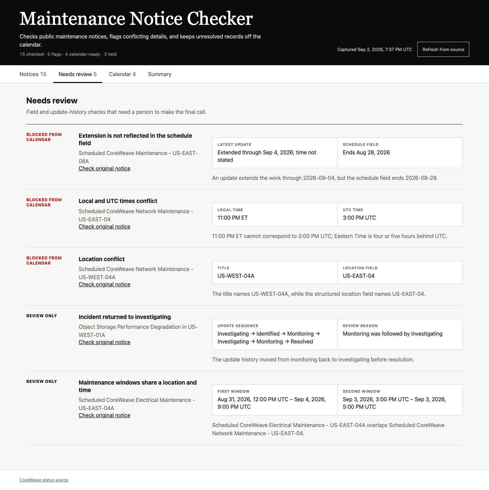

# Maintenance Notice Checker

This project reads CoreWeave's public status page and RSS feed, checks each
maintenance notice for inconsistent locations, dates, times, extensions, missing
details, and overlapping windows, then produces a review-gated calendar and a
downloadable maintenance summary.

The checked-in records are public source captures, not invented operating data.
Each capture includes its source URL, retrieval time, and SHA-256 hash. The app
does not claim access to CoreWeave systems, employees, telemetry, or internal
procedures.

**[Live demo](https://duckky153.github.io/maintenance-checker/)**
·
**[Review guide](https://duckky153.github.io/maintenance-checker/guide.html)**



## Archived evidence

The September 2, 2026 snapshot contains 15 distinct public notices: 12
maintenance records and three incidents. The saved cases cover an extension
beyond the structured end date, an impossible local/UTC time pair, a title and
location-field conflict, overlapping windows under one location code, and an
incident that returned from monitoring to investigating.

## Run it

Needs Node.js 20 or newer. `npm run verify` drives a real browser, so install
Playwright's Chromium once first.

```bash
npm install
npx playwright install chromium
npm run fetch
npm run verify
npm run serve
```

Open `http://127.0.0.1:4180`.

`npm run fetch` pulls the current public pages and `npm run verify` regenerates
the browser screenshots, so both overwrite files under `data/`, `site/` and
`evidence/` with fresh output. The notice count then differs from the archived
September 2 snapshot described above.

## Public demo

The `site/` folder also runs as a static GitHub Pages site. In that mode the
dashboard reads the latest validated `data.json`, keeps every source and download
link working under the repository path, and hides the server-only refresh button.
The included Pages workflow refreshes the public CoreWeave sources, runs the full
verification suite, and publishes only after every check passes. If a scheduled
refresh fails, GitHub Pages keeps the last successful release available.

The verified public demo is available at
[duckky153.github.io/maintenance-checker](https://duckky153.github.io/maintenance-checker/).

## What to demonstrate

1. Open **Notices** to see the source records and update history.
2. Open **Needs review** to compare conflicting source fields.
3. Open **Calendar** to see which records passed the readiness checks and which
   records were held for review.
4. Open **Summary** to download the maintenance brief or `.ics` calendar.

## Local integration

While the local server is running, `GET /api/report` returns the checked JSON,
`GET /calendar.ics` returns only calendar-ready maintenance, `GET /health`
reports the current schema and counts, and `POST /api/refresh` performs a
validated source refresh. See [docs/INTEGRATION.md](docs/INTEGRATION.md).

## Evidence boundary

- Source: `https://status.coreweave.com/`
- Feed: `https://status.coreweave.com/pages/5e126e998f2f032e1f8f0f4b/rss`
- Product data: public incidents and maintenance notices only
- Tests: captured real source records, rejection tests derived from those
  captures, live source-contract checks, and browser verification
- Claims: parser, validation, calendar, summary, tests, and documentation
- Not claimed: internal access, employee research, deployment, adoption, time
  saved, errors prevented, or operational impact

The [review guide](https://duckky153.github.io/maintenance-checker/guide.html) explains source conflicts, calendar holds, handoff and failed refreshes. The [user guide](docs/USER-GUIDE.md) also compares the manual and checked workflows without claiming measured savings.
